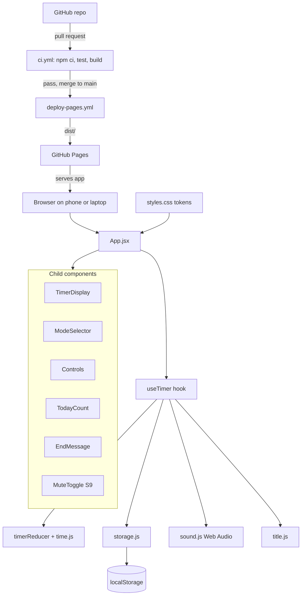

# Solution Design Document (Lite): Pomodoro Timer

## Overview

Pomodoro Timer is a proof of concept (POC) for a demo, not a production system (Q1). It is a static, front-end-only React app for one focused solo worker, such as a student or remote worker, on a phone or laptop (Q2).

It runs a large MM:SS countdown with three fixed modes: Focus 25:00, Short break 05:00 and Long break 15:00. At 00:00 it plays a sound and shows an in-page message. It then suggests the next mode and keeps today's count and the 4-session cycle in localStorage.

The chosen stack is plain React 18 with hooks:

- a pure timer reducer (`useReducer`);
- pure helper modules for time maths;
- a small storage module for localStorage.

It adds no runtime dependencies to the starter template (React 18 + Vite 5, Vitest 2 + Testing Library + jsdom). The template's workflows deploy it as a static site to GitHub Pages (Q8, Q10). There is no server, database, login or secret (Q5, Q7).

## Questionnaire summary

| Q | Answer in brief | Design consequence |
|---|---|---|
| Q1 | POC for a demo, single-tenant, lifespan of about one sprint plus the demo | Minimal design. No feature flags, multi-tenancy or migration tooling beyond a storage version field. |
| Q2 | One user or a handful of demo users; phones and laptops; 320–1920 px; English only | Responsive CSS from 320 px up. Buttons are at least 44 × 44 px. UI strings are hard-coded in English. There is no scale design. |
| Q3 | Best effort on GitHub Pages; no SLA, RTO, RPO or monitoring | Static hosting only. Rollback means redeploying the previous commit. No health checks or telemetry. |
| Q4 | Interactive in 2 s or less; refresh at least once per second; within 1 s of the end timestamp | Remaining time is derived from `endsAt - Date.now()`. A 250 ms interval refreshes the display. The bundle stays small, with no extra libraries. |
| Q5 | No auth, no PII, no network calls after load; localStorage holds only date, count, cycle and mute | One versioned storage key with no personal data. No cookies or analytics. The sound is generated in the browser, never fetched. |
| Q6 | No AI; no data sent to external APIs | No AI or external API components. |
| Q7 | No integrations; browser APIs only (localStorage, Date, Web Audio, document.title) | Each browser API is wrapped in its own small module (`storage`, `sound`, `title`), so tests can mock it. |
| Q8 | GitHub Pages from sdlc-demo-apps/sdlc-pomodoro-timer-r6; ci.yml and deploy-pages.yml | Keep the npm scripts. Set the Vite `base` to `/sdlc-pomodoro-timer-r6/`. Deploy `dist/`. |
| Q9 | Build agent on React/Vite/Vitest; the Admin owns operations; no monitoring | Pure modules keep tests simple and deterministic with fake timers. No operations tooling. |
| Q10 | Free hosting, open source, one sprint (23/24 points); S9 is Could Have | No new dependencies. The `muted` field is in the storage shape from the start, defaulting to false, so S9 can be added cheaply. |

## Architecture diagram



The diagram reads as follows:

- **Styles:** `styles.css` is imported by `App.jsx` and styles all child components.
- **State flow:** the child components get state and callbacks from `App.jsx`, which gets them from `useTimer`.
- **Delivery:** CI must pass on the pull request before the merge to `main`. The merge triggers `deploy-pages.yml`, which publishes `dist/` to Pages.

## Components

| Component (file) | Responsibility | Stories served |
|---|---|---|
| `index.html` | Template file, edited. Sets the `<title>` to "Pomodoro Timer" and keeps or adds the viewport meta tag (`width=device-width, initial-scale=1`). Holds the root element. | S8, S10 |
| `src/main.jsx` | Mounts `<App />`. Template file, unchanged. | All |
| `src/App.jsx` | Imports `styles.css` and gets its state from `useTimer`. Lays out the screen: `ModeSelector`, `TimerDisplay`, `Controls`, `TodayCount` and `EndMessage`, plus `MuteToggle` only if S9 is built. | S1, S2, S4, S6, S10 |
| `src/components/TimerDisplay.jsx` | Shows the large MM:SS digits. It is not an aria-live region, so the countdown is not announced every second. | S1, S3 |
| `src/components/ModeSelector.jsx` | Shows the Focus, Short break and Long break buttons. The active mode has `aria-pressed="true"` and a non-colour marker (underline and weight). | S2 |
| `src/components/Controls.jsx` | Shows Start or Pause, and Reset. | S1 |
| `src/components/TodayCount.jsx` | Shows "Today: N focus sessions". | S6 |
| `src/components/EndMessage.jsx` | Shows the end-of-session message in an `aria-live="polite"` region, with a Dismiss button. | S4 |
| `src/components/MuteToggle.jsx` | Mute button with `aria-pressed`. Created only if S9 is built (Could Have). | S9 |
| `src/hooks/useTimer.js` | Wires the reducer to time and side effects:<br>• runs a 250 ms interval while running and dispatches `TICK` with `Date.now()`;<br>• loads and saves storage;<br>• plays the sound and sets the title. | S1, S3, S4, S6, S7, S8 |
| `src/timer/timerReducer.js` | Pure state machine with the actions START, PAUSE, RESET, SET_MODE, TICK, DISMISS and LOAD. It applies the midnight rollover and the completion, count, cycle and next-mode rules exactly once. TOGGLE_MUTE is added only if S9 is built; until then `muted` stays false. | S1, S2, S3, S5, S6, S7 |
| `src/timer/time.js` | Pure helpers: durations, `formatMMSS`, `remainingMs`, `localDateKey` and `nextMode`. | S1, S3, S5, S6 |
| `src/services/storage.js` | Reads and writes the versioned localStorage record. Falls back to defaults on missing, malformed or unknown-version data. | S6, S7, S9 |
| `src/services/sound.js` | Generates a short beep with the Web Audio API (about 0.4 s at 880 Hz). Unlocks audio on the first Start. No audio file is bundled (A6). | S4, S9 |
| `src/services/title.js` | Builds and sets `document.title`. | S8 |
| `src/styles.css` | Design tokens and responsive layout (320–1920 px), 44 px touch targets and the focus ring. Imported by `App.jsx`. | S10 |

## Data flow

Main action: the user presses Start on Focus, and the session reaches 00:00.

1. The user presses **Start**. `Controls` calls `start()` from `useTimer`.
2. `useTimer` calls `sound.unlock()` to satisfy the autoplay policy. It then dispatches `{type:'START', now: Date.now()}`.
3. `timerReducer` sets `status='running'` and `endsAt = now + remainingMs`. `endsAt` is recomputed on every resume (S3).
4. While the timer runs, a 250 ms interval dispatches `TICK` with `Date.now()`. The reducer first runs the midnight check (step 5), then computes `remainingMs = max(0, endsAt - now)` (Q4).
5. **Midnight check.** If `localDateKey(now)` differs from `state.date`, the reducer sets `state.date` to the new key and `todayCount` to 0. It keeps `cycle` (A3). The same check runs in LOAD.
6. The re-render shows `formatMMSS(remainingMs)`. A `useEffect` sets the tab title, for example `"24:57 · Focus · Pomodoro Timer"` (S8).
7. When the tab is in the background, ticks may stop. The next TICK computes the time from `endsAt`, so the display is correct (S3).
8. When a TICK finds `remainingMs === 0` and `status==='running'`, the reducer completes the session once, using the Completion rules table:
   - it sets `status='stopped'`;
   - it updates the count and cycle;
   - it sets `mode = nextMode(...)` and loads that mode's full duration;
   - it sets `message`, worded for the actual next mode;
   - it increments `completionId`.

   Because the status is now stopped, later ticks cannot complete the session again. Because the midnight check runs first, a session that ends after midnight counts toward the new day.
9. A `useEffect` on `completionId` calls `sound.play()` unless the timer is muted. `EndMessage` announces the text through aria-live (S4).
10. A `useEffect` on `{date, todayCount, cycle, muted}` calls `storage.save(...)`, which writes `pomodoro-timer:v1` to localStorage (S6, S7).
11. The title returns to "Pomodoro Timer" while the timer is stopped. On reload, `storage.load(today)` restores the count and cycle, and the timer starts stopped at the full duration of its mode (S7).

## Interfaces and storage contract

There is no server API (Q5, Q7). The contracts below are module interfaces and one localStorage key.

### Module functions

| Module | Function | Inputs | Output | Errors |
|---|---|---|---|---|
| time.js | `durationMs(mode)` | `'focus' \| 'short' \| 'long'` | 1500000 \| 300000 \| 900000 | Throws `RangeError` on an unknown mode |
| time.js | `formatMMSS(ms)` | number of ms, 0 or more | `"MM:SS"`, rounded up to the whole second | Negative input is clamped to `"00:00"` |
| time.js | `remainingMs(endsAt, now)` | two epoch ms values | `max(0, endsAt-now)` | none |
| time.js | `localDateKey(now)` | epoch ms | `"YYYY-MM-DD"` (local time) | none |
| time.js | `nextMode(endedMode, cycle)` | ended mode and the cycle after the update | `'long'` after focus if the cycle is 4, `'short'` after focus otherwise, `'focus'` after any break | none |
| timerReducer.js | `timerReducer(state, action)` | state and action | new state (pure) | Unknown action returns the state unchanged |
| timerReducer.js | `initialState(saved, todayKey)` | stored record or defaults, and today's key | state with Focus at 25:00, stopped, `date = todayKey` | none |
| storage.js | `load(todayKey)` | `"YYYY-MM-DD"` | `{todayCount, cycle, muted}`; the count is 0 if the stored date ≠ today | Never throws. Returns defaults on missing, malformed or unknown-version data, or if storage is unavailable (NFR-06). |
| storage.js | `save(record)` | `{date, todayCount, cycle, muted}` | void | Catches and ignores quota or security errors |
| sound.js | `unlock()` / `play()` | none | void | Catches errors when Web Audio is missing or blocked (A7) |
| title.js | `buildTitle(state)` / `setTitle(text)` | state / string | string / void | none |
| useTimer.js | `useTimer()` | none | `{state, start, pause, reset, setMode, dismiss}`, plus `toggleMute` only if S9 is built | none |

### Storage contract

- **Key:** `pomodoro-timer:v1`. It is the only key used.
- **JSON shape:**

```json
{ "version": 1, "date": "2026-11-26", "todayCount": 3, "cycle": 3, "muted": false }
```

- **Validation:**
  - `version` must equal 1.
  - `date` must match `^\d{4}-\d{2}-\d{2}$`.
  - `todayCount` must be an integer, 0 or more.
  - `cycle` must be an integer from 0 to 4.
  - `muted` must be a boolean if present.
  - Any failure returns the defaults `{todayCount:0, cycle:0, muted:false}`.
- **Midnight:** on load and on every TICK, a stored or state date different from today's local key does three things (A3, A4):
  - sets `date` to today;
  - sets `todayCount` to 0;
  - keeps `cycle`.

  The next save writes the new date, so a reload after midnight never shows yesterday's count.
- **Not stored:** the running timer, `endsAt` and the mode (BR-07).
- **Mute:** `muted` is always written, as false unless S9 is built and the user turns mute on (A8).

## Data model

**TimerState** (in memory, reducer)

| Field | Type | Required | Description |
|---|---|---|---|
| mode | `'focus' \| 'short' \| 'long'` | Yes | Current mode. `'focus'` on load. |
| status | `'stopped' \| 'running' \| 'paused'` | Yes | Timer status. |
| remainingMs | number | Yes | Milliseconds left, shown as MM:SS. |
| endsAt | number \| null | Yes | Epoch ms at which the session ends. Null unless running. |
| date | string `YYYY-MM-DD` | Yes | Local date that `todayCount` belongs to. Set to today on load, and updated to the new key by the midnight check on TICK or LOAD. |
| todayCount | integer | Yes | Focus sessions completed on `date`. Set to 0 when `date` rolls over. |
| cycle | integer 0–4 | Yes | Focus sessions completed since the last long break. Not reset at midnight. |
| muted | boolean | Yes | Sound is off when true. Default false. It changes only through TOGGLE_MUTE (S9). |
| message | string \| null | Yes | End-of-session text, or null after Dismiss. |
| completionId | integer | Yes | Incremented once per completion. Triggers the sound. |

**StoredRecord** (localStorage `pomodoro-timer:v1`)

| Field | Type | Required | Description |
|---|---|---|---|
| version | integer (1) | Yes | Schema version. |
| date | string `YYYY-MM-DD` | Yes | Local date of `todayCount`. |
| todayCount | integer ≥ 0 | Yes | Today's completed focus sessions. |
| cycle | integer 0–4 | Yes | Cycle position. It stays at 4 until a long break is taken (A2). |
| muted | boolean | No | Mute setting (S9). Defaults to false if absent. |

**Completion rules** (reducer, applied after the midnight check):

| Ended mode | Count | Cycle | Next mode | Message (exact text) |
|---|---|---|---|---|
| focus, new cycle 1–3 | +1 | `cycle+1` | `'short'` | "Focus session complete. Time for a short break." |
| focus, new cycle 4 | +1 | `min(cycle+1, 4)` = 4 | `'long'` | "Focus session complete. Time for a long break." |
| short | unchanged | unchanged | `'focus'` | "Break over. Ready to focus?" |
| long | unchanged | 0 | `'focus'` | "Break over. Ready to focus?" |

The message text is chosen from the computed next mode, so it always matches the mode the app switches to (S4, S5).

## Technology stack

| Layer | Choice | Version | Justification | Questionnaire ref |
|---|---|---|---|---|
| UI framework | React (function components, `useReducer`) | 18.x | Template stack. The reducer keeps the time logic pure and testable. | Q8, Q9 |
| Build tool | Vite | 5.x | Template. Fast build of a static `dist/` for Pages. | Q4, Q8 |
| Language | JavaScript (JSX, ES modules) | ES2020 | Matches the template. No TypeScript setup is needed in one sprint. | Q9, Q10 |
| Styling | Plain CSS with custom properties | n/a | No dependency. Tokens come from the Phase 4 mockup. | Q4, Q10 |
| Sound | Web Audio API (OscillatorNode) | Browser built-in | No audio file and no network fetch (A6). | Q5, Q7 |
| Persistence | localStorage, one versioned key | Browser built-in | No server or database. Holds no PII. | Q5, Q7 |
| Unit and integration tests | Vitest + Testing Library + jsdom | 2.x / current / current | Template. Fake timers and `vi.setSystemTime` handle time. | Q9 |
| CI | GitHub Actions `ci.yml` | Template | Runs `npm ci`, `npm test` and `npm run build` on each PR. | Q8 |
| Hosting | GitHub Pages via `deploy-pages.yml` | Free tier | Mandated, best effort and free. | Q3, Q8, Q10 |

## Repository structure

```
sdlc-pomodoro-timer-r6/
├── .github/
│   └── workflows/
│       ├── ci.yml                    (template, unchanged)
│       └── deploy-pages.yml          (template, unchanged)
├── index.html                        (template, edited: <title>Pomodoro Timer</title>, viewport meta)
├── package.json                      (template, unchanged: scripts and dependencies)
├── vite.config.js                    (template, edited: base '/sdlc-pomodoro-timer-r6/')
└── src/
    ├── main.jsx                      (template, unchanged)
    ├── App.jsx                       (template, rewritten; imports styles.css)
    ├── App.test.jsx                  (template, rewritten: integration tests)
    ├── styles.css                    (new)
    ├── components/                   (new)
    │   ├── TimerDisplay.jsx
    │   ├── ModeSelector.jsx
    │   ├── Controls.jsx
    │   ├── TodayCount.jsx
    │   ├── EndMessage.jsx
    │   └── MuteToggle.jsx            (S9, only if built)
    ├── hooks/                        (new)
    │   ├── useTimer.js
    │   └── useTimer.test.js
    ├── timer/                        (new)
    │   ├── time.js
    │   ├── time.test.js
    │   ├── timerReducer.js
    │   └── timerReducer.test.js
    └── services/                     (new)
        ├── storage.js
        ├── storage.test.js
        ├── sound.js
        ├── sound.test.js
        ├── title.js
        └── title.test.js
```

No audio file is added, because the sound is generated with Web Audio (A6, Q5). If S9 is not built, `MuteToggle.jsx` and the TOGGLE_MUTE action are not created, and `muted` stays false.

## Environment variables and build configuration

- **Environment variables: none.** The app has no server, API keys or secrets (Q5, Q7). All values are constants in the code.
- **Vite base path:** `base: '/sdlc-pomodoro-timer-r6/'` in `vite.config.js`, so assets resolve at https://sdlc-demo-apps.github.io/sdlc-pomodoro-timer-r6/ (Q8).
- **Test config:** `test: { environment: 'jsdom', globals: true }`, as in the template.
- **npm scripts:** `dev`, `build` and `test` are kept unchanged (Q8).

## Testing approach

All tests use Vitest 2 with `vi.useFakeTimers()` and `vi.setSystemTime()`. The sound is mocked with `vi.mock` of `services/sound` everywhere except `sound.test.js`. localStorage is cleared in `beforeEach` (Q9).

| Test file | Level | What is tested | Stories |
|---|---|---|---|
| `time.test.js` | Unit | Durations. `formatMMSS` (rounding, 0, 25:00). The `remainingMs` clamp. `localDateKey` around midnight. `nextMode` for cycles 1–4 and after breaks. | S1, S3, S5, S6 |
| `timerReducer.test.js` | Unit | START, PAUSE, RESET and SET_MODE. A new `endsAt` on resume. A jump to T + 10 min reads 15:00. An overdue TICK completes once, and a repeat TICK changes nothing. Count and cycle rules; the cycle is capped at 4; the cycle resets after a long break. Exact message text for the short-break, long-break and break-over cases. A mode switch doesn't count. Midnight rollover sets `date` to the new key and `todayCount` to 0, and keeps `cycle`. A Focus session that ends just after midnight gives a count of 1 on the new date. | S1, S2, S3, S4, S5, S6, S7 |
| `storage.test.js` | Unit | Key name and JSON shape with `version: 1`. Round trip. Missing data, malformed JSON, the wrong version and out-of-range values give defaults. Yesterday's date gives a count of 0 and keeps the cycle. A throwing `setItem` is ignored. | S6, S7, S9 |
| `sound.test.js` | Unit | With a stubbed `AudioContext`, `play()` creates one oscillator. Without `AudioContext`, or when it throws, `unlock()` and `play()` do not throw. | S4 |
| `title.test.js` | Unit | `"24:57 · Focus · Pomodoro Timer"` while running. `"Pomodoro Timer"` when paused or stopped. | S8 |
| `useTimer.test.js` | Unit (`renderHook`) | The interval runs only while running and is cleared on pause or unmount. `sound.play` is called once per `completionId`. `storage.save` is called with the updated date, count and cycle. `document.title` is updated. | S3, S4, S6, S7, S8 |
| `App.test.jsx` | Integration (Testing Library) | First render shows Focus and 25:00. Start plus 3 s shows 24:57 and a Pause button. Pause holds for 10 s. Reset works. Mode buttons and `aria-pressed`. Session end calls the sound mock once and shows the aria-live message, which Dismiss removes. The switch to the next mode is shown. The count survives unmount and remount (reload). A reload during a run shows 25:00. `Notification.requestPermission` is never called. The viewport meta tag and button classes are present. | S1, S2, S4, S5, S6, S7, S8, S10 |

Two checks cannot be automated in jsdom. Both are done by hand on the deployed site and listed as known issues for the Test Report:

- layout at 320 px and the 44 px touch targets (S10);
- audible sound on a real device (S4).

## ADRs

### ADR-1: Tech stack

- **Context:** The app must be built on the starter template. It must keep the npm scripts and the Pages deployment, and fit one sprint at zero cost (Q8, Q9, Q10).
- **Options considered:**
  1. Plain React with hooks and a pure timer reducer (no extra dependencies).
  2. React with a state library (for example Zustand) and a localStorage persist middleware.
  3. React with an XState state machine for the timer.
- **Decision:** Option 1, chosen by the Admin.
- **Rationale:**
  - It adds no dependencies, so the bundle stays small (Q4) and the tooling stays open source and free (Q10).
  - A pure reducer is easy to test with fake timers (Q9).
  - The scope is small (Q1).
- **Consequences:** The completion and next-mode rules are hand-written and must be fully unit-tested. Persistence is handled by our own `storage.js`.
- **Status:** Accepted

### ADR-2: Time keeping from an end timestamp

- **Context:** Browsers throttle timers in background tabs, but the display must stay within 1 s of the true remaining time (Q4, BR-03).
- **Options considered:**
  1. Decrement a counter on each `setInterval` tick.
  2. Store `endsAt` and derive the remaining time from `Date.now()` on each tick.
  3. Run the countdown in a Web Worker.
- **Decision:** Option 2, with a 250 ms interval and completion detected in the reducer, guarded by `status`.
- **Rationale:** It is accurate after any gap, simple, and deterministic under `vi.setSystemTime`. A Web Worker adds complexity, and its timers can still be throttled (Q4, Q9).
- **Consequences:** The sound may still be late or silent on a locked phone (A7, a known limitation). Resume must recompute `endsAt`.
- **Status:** Accepted

### ADR-3: Storage design

- **Context:** The count, cycle and mute setting must survive a reload. The data must not be personal, and the app must tolerate bad data (Q5, NFR-06).
- **Options considered:**
  1. One versioned JSON key, `pomodoro-timer:v1`.
  2. Separate keys per field (`count`, `date`, `cycle`, `muted`).
  3. IndexedDB.
- **Decision:** Option 1.
- **Rationale:** An atomic write keeps the date and count consistent. The version field allows a safe fallback. IndexedDB is too much for 4 fields (Q5, Q10).
- **Consequences:** A future schema change needs a `v2` key or a migration in `load`. The running timer is never stored (BR-07).
- **Status:** Accepted

## Sign-off

| Role | Name | Decision | Date |
|---|---|---|---|
| Approver (Sponsor, Product Owner) | Admin | Pending gate approval | — |

**Status:** Pending gate approval (Gate 3: SDD sign-off). Phase 4 (UI design) begins after approval.
